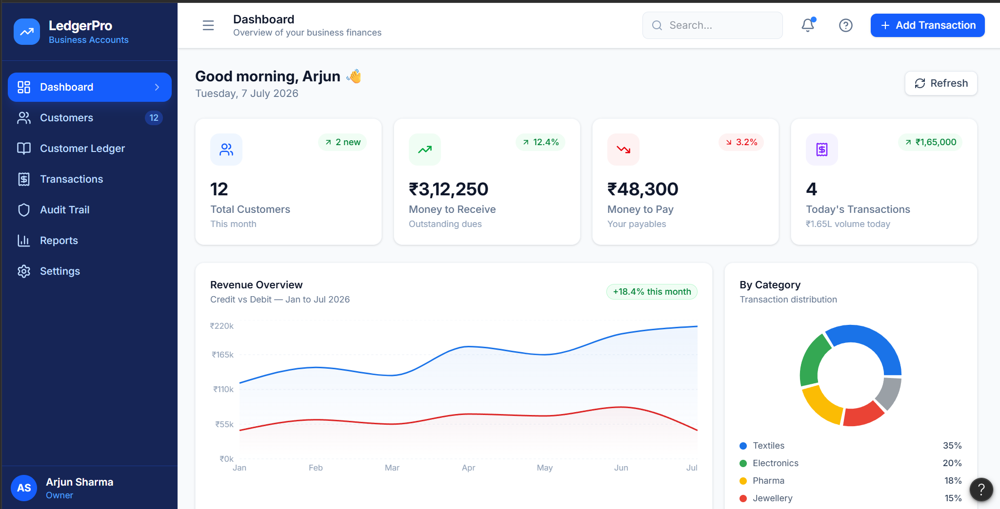
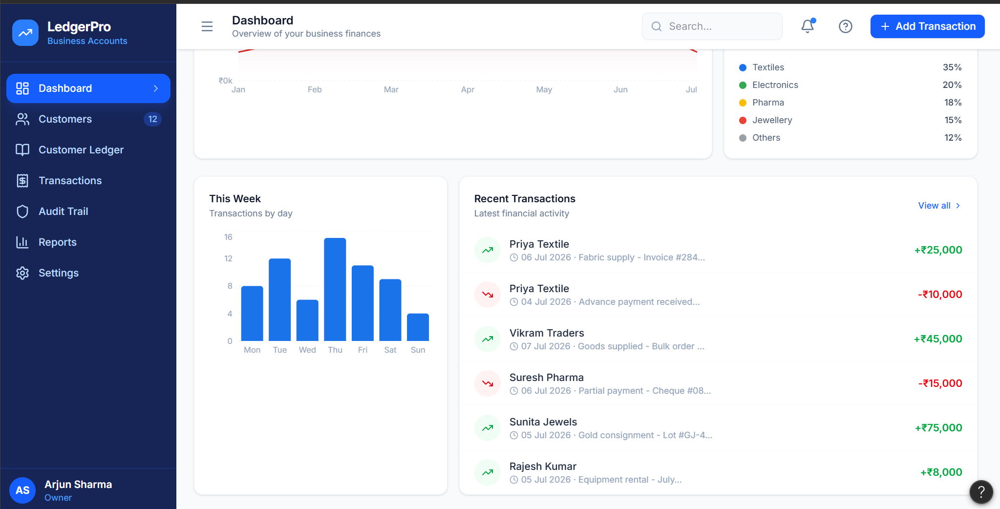
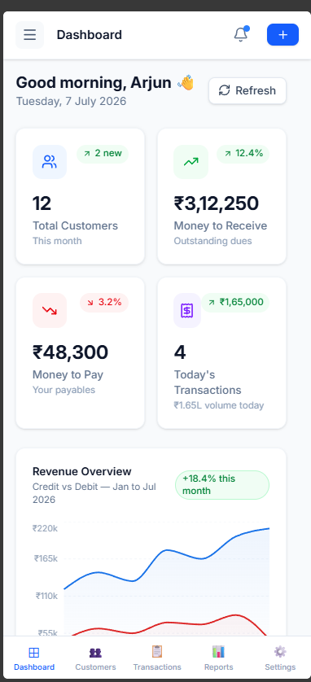
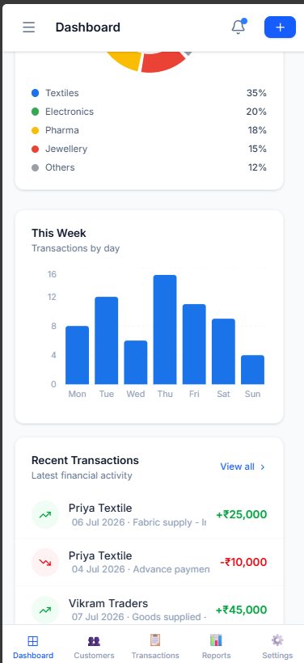

# Digital Ledger Management System

## Design References

Below are the initial UI mockups created in Figma. These were used to finalize the overall layout, navigation flow, and color palette before development.

### Dashboard

### Ledger View

### Mobile Dashboard

### Mobile Ledger View

> These designs are rough prototypes and may evolve during development.

---

# Product Requirements

## Overview

The Digital Ledger Management System is a web application inspired by Khatabook that helps shopkeepers digitally manage customer credit and debit transactions.

Instead of maintaining paper khata books, users can record transactions, view an automatically updated running balance, search transaction history, and keep track of every modification through an audit trail.

---

## Problem Statement

Traditional paper ledgers are difficult to maintain and often lead to:

- Lost or damaged records
- Manual calculation mistakes
- Difficulty searching previous transactions
- No history of edits or deletions

This project aims to replace manual bookkeeping with a secure digital ledger.

---

## Objectives

The application allows users to:

- Add new transactions
- Edit existing transactions
- Soft delete transactions
- View running balances
- Search transaction history
- Filter transactions
- Maintain an audit trail
- Prevent multiple users from editing the same transaction simultaneously

---

## Features

### Transaction Management

- Add Transaction
- Edit Transaction
- Soft Delete Transaction
- View Transaction History

Each transaction contains:

- Customer Name
- Amount
- Transaction Type (Given / Taken)
- Date
- Description

---

### Running Balance

The running balance updates automatically whenever a transaction is added, edited, or deleted.

Example:

| Transaction | Amount | Balance |
|-------------|--------|---------|
| Given | ₹1000 | ₹1000 |
| Taken | ₹300 | ₹700 |
| Given | ₹500 | ₹1200 |

---

### Search & Filters

Users can search transactions by:

- Customer Name

Filters include:

- Given
- Taken
- Month

---

### Pagination

Transaction history is paginated to improve performance.

- 20 records per page
- Previous / Next navigation

---

### Audit Trail

Every transaction change is permanently recorded.

Each audit entry stores:

- Transaction ID
- Action (Create, Update, Delete)
- Previous Value
- New Value
- Edited By
- Edited Time

Audit records cannot be modified.

---

### Concurrent Editing

To avoid conflicting changes, only one user can edit a transaction at a time.

If another user opens the same transaction:

- Editing is disabled
- The page becomes read-only
- A message informs the user that the record is currently locked

---

## Data Models

### Transaction

- Transaction ID
- Customer Name
- Amount
- Transaction Type
- Description
- Transaction Date
- Running Balance
- Created At
- Updated At
- Deleted At (Soft Delete)

### Audit Log

- Audit ID
- Transaction ID
- Action
- Previous Value
- New Value
- Edited By
- Edited At

---

## Business Rules

- Running balance updates automatically.
- Transactions are never permanently deleted.
- Deleted transactions remain available in the audit log.
- Only one user may edit a transaction at a time.
- Audit logs are immutable.

---

## Future Improvements

Possible features for future versions include:

- WhatsApp/SMS reminders
- Reports and analytics
- Export to PDF/Excel
- Customer statements
- Multi-user roles
- Offline support
- Real-time notifications

---

## Tech Stack

### Frontend

- React
- Vite
- TypeScript
- Material UI
- React Router
- TanStack Query
- Axios

### Backend

- Node.js
- Express
- PostgreSQL
- Prisma ORM
- JWT Authentication

---

## Conclusion

The Digital Ledger Management System provides a modern alternative to traditional paper ledgers by offering secure transaction management, automatic balance calculation, audit history, and efficient search capabilities. The project is designed to be simple, scalable, and suitable for small businesses managing daily customer transactions.